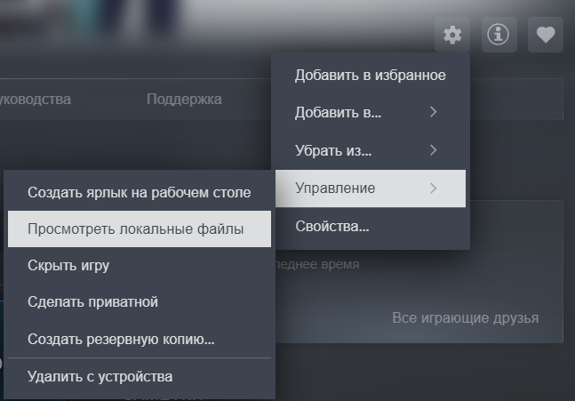

1. Закройте Computer Tycoon 0.9.9.19.
2. Откройте папку игры: Steam → «Computer Tycoon» → «Настройки» → «Управление» → «Просмотреть локальные файлы».

   

3. Распакуйте всё содержимое архива в эту папку, рядом с `.exe` игры, и согласитесь на замену файлов.
4. Запустите игру. Первый запуск может занять больше времени; русский язык включится автоматически.
